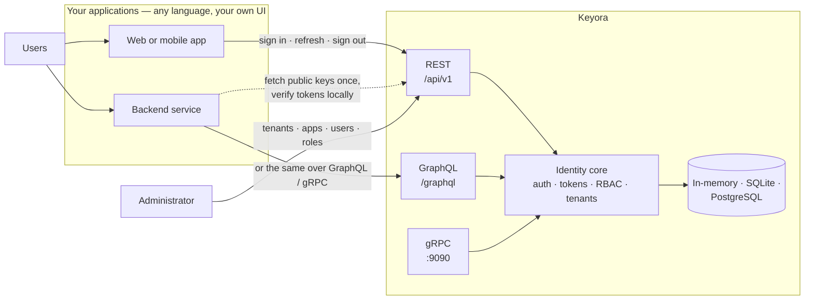

<p align="center">
  <picture>
    <source media="(prefers-color-scheme: dark)" srcset="assets/logo-dark.svg">
    
  </picture>
</p>

<p align="center">
  <strong>Self-hosted, API-only identity and authentication for every application you run.</strong><br>
  One static Go binary. REST, GraphQL and gRPC. Zero third-party dependencies in the core.
</p>

<p align="center">
  <a href="https://github.com/rabbicse/keyora/actions/workflows/ci.yml"></a>
  &nbsp;·&nbsp; <a href="#getting-started">Getting started</a>
  &nbsp;·&nbsp; <a href="docs/integration.md">Integration guide</a>
  &nbsp;·&nbsp; <a href="api/openapi.yaml">REST reference</a>
  &nbsp;·&nbsp; <a href="docs/graphql.md">GraphQL</a>
  &nbsp;·&nbsp; <a href="docs/grpc.md">gRPC</a>
  &nbsp;·&nbsp; <a href="examples/">Examples</a>
</p>

---

Keyora signs your users in, issues and rotates their tokens, and tells your
applications who is calling and what they may do. You run it next to your services.
They call it over REST, GraphQL or gRPC, and verify its tokens locally without a
network round trip.

Keyora is **API only**. It serves no pages, sets no cookies and never redirects a
browser. Every screen your users see belongs to your application; Keyora is the
backend behind it.

It implements three open standards and nothing proprietary:

| Standard | What Keyora uses it for |
|---|---|
| [OAuth 2.0](https://datatracker.ietf.org/doc/html/rfc6749) | Authorization code flow with PKCE, refresh tokens, client credentials |
| [JSON Web Token (JWT)](https://datatracker.ietf.org/doc/html/rfc7519) | RS256-signed access tokens any service can verify offline |
| [OpenID Connect](https://openid.net/specs/openid-connect-core-1_0.html) | ID tokens, userinfo and discovery on top of the OAuth flow |

> **Status: early (pre-release).** Everything described here is implemented and
> tested, but Keyora has not had an independent security audit and its API may change
> before 1.0. Single sign-on across applications, social login and multi-factor
> authentication are not built yet — see the [roadmap](docs/roadmap.md).

## Contents

- [Why Keyora](#why-keyora)
- [Features](#features)
- [How it fits together](#how-it-fits-together)
- [Getting started](#getting-started) — eleven steps from nothing to a protected API
- [Apps without a secret: authorization code with PKCE](#apps-without-a-secret-authorization-code-with-pkce)
- [One core, three APIs: REST, GraphQL, gRPC](#one-core-three-apis-rest-graphql-grpc)
- [Examples in your language](#examples-in-your-language)
- [Going to production](#going-to-production)
- [Configuration](#configuration) · [Documentation](#documentation) · [Development](#development) · [Security](#security) · [License](#license)

## Why Keyora

- **It stays small.** A single binary or a small distroless container, with an
  embedded database if you want one. No runtime, no cluster, no sidecars.
- **You can read all of it.** The core — routing, JWT, password hashing, rate limiting,
  logging, metrics — is the Go standard library and nothing else, and a build check
  keeps it that way.
- **It fits your stack.** Applications in Go, TypeScript, Python, Java, .NET, PHP, Rust
  or Ruby integrate with standard libraries, over whichever of REST, GraphQL or gRPC
  suits them. Nobody needs Go.
- **Security is the default.** PKCE is mandatory, refresh tokens rotate and detect
  theft, secrets are stored only as hashes, tenants cannot see each other, and the same
  checks guard all three APIs.

## Features

<table>
<tr>
<td width="50%" valign="top">

**Identity**
- Registration, login, profile, password change
- Email verification and password reset
- Brute-force lockout, account disable, admin unlock

**Tokens and sessions**
- RS256 access tokens with a JWKS endpoint
- Rotating refresh tokens with reuse detection
- Per-device sessions you can list and revoke
- Live token introspection

</td>
<td width="50%" valign="top">

**OAuth 2.0 and OpenID Connect**
- Authorization code flow with mandatory PKCE, API only
- Refresh-token and client-credentials grants
- ID tokens, userinfo, discovery

**Authorization and tenancy**
- Roles and permissions carried in the token
- Isolated tenants, many applications per tenant
- Confidential (server) and public (browser, mobile) applications

</td>
</tr>
<tr>
<td valign="top">

**APIs and storage**
- REST with an OpenAPI description
- GraphQL (`POST /graphql`) and gRPC with published `.proto` files
- In-memory, SQLite, or PostgreSQL (also through PgBouncer)
- Built-in migrations

</td>
<td valign="top">

**Operations**
- JSON logs, request IDs, Prometheus metrics, health probes
- Rate limiting, CORS, security headers
- Audit trail of every security event
- Graceful shutdown, non-root container

</td>
</tr>
</table>

## How it fits together



1. Your application collects the user's email and password in its own interface and
   sends them to Keyora.
2. Keyora answers with a short-lived **access token** (a signed JWT) and a
   **refresh token**.
3. Your services verify the access token **locally** with Keyora's public keys, and
   read the user's roles and permissions from it. No call to Keyora per request.
4. When the access token expires, the application exchanges the refresh token for a
   new pair.

## Getting started

This walk-through takes you from nothing to an API that only signed-in users with the
right permission can call. Every command was run against a real Keyora; the responses
shown are what it returned, shortened where marked with `…`.

### Step 0 — Prerequisites

| You need | For |
|---|---|
| Docker, **or** Go 1.26+ | Running Keyora |
| `curl` | Calling the API |
| `jq` | Capturing IDs from responses in the commands below (optional, but the steps assume it) |
| `openssl` | Generating secrets |

### Step 1 — Start Keyora

Pick one way to run it. All three listen on port `8080` (REST and GraphQL).

**Option A — Docker Compose, from this repository** (SQLite inside the container):

```sh
git clone https://github.com/rabbicse/keyora.git && cd keyora
export KEYORA_ADMIN_KEY="$(openssl rand -hex 32)"      # root management credential; keep it secret
docker compose -f deploy/docker-compose.sqlite.yml up -d --build
```

This also publishes gRPC on port `9090`. For PostgreSQL use the root
`docker-compose.yml` instead.

**Option B — the published container image:**

```sh
export KEYORA_ADMIN_KEY="$(openssl rand -hex 32)"
docker run -d --name keyora -p 8080:8080 -p 9090:9090 \
  -e KEYORA_ADMIN_KEY -v keyora-data:/data ghcr.io/rabbicse/keyora:latest
```

Images are published for each release. Check the
[release notes](https://github.com/rabbicse/keyora/releases) for what a tag contains:
features in this README that are newer than the latest release need option A or C.

**Option C — build the binary from source:**

```sh
git clone https://github.com/rabbicse/keyora.git && cd keyora
export KEYORA_ADMIN_KEY="$(openssl rand -hex 32)"
make build                                   # writes bin/keyora
KEYORA_GRPC_ADDR=:9090 ./bin/keyora serve    # SQLite in ./data; omit KEYORA_GRPC_ADDR to leave gRPC off
```

On first start Keyora creates its database schema and its first signing key. Check
that it is ready:

```sh
curl http://localhost:8080/readyz
```
```json
{"database":"up","status":"ok","version":"v0.2.0"}
```

The rest of the guide uses this variable:

```sh
export KEYORA=http://localhost:8080
```

### Step 2 — Create a tenant

A **tenant** is an isolated space with its own users, roles and applications —
typically one per customer organisation or per product. Tenants are created with the
root admin key.

```sh
curl -s -X POST $KEYORA/api/v1/tenants \
  -H "Authorization: Bearer $KEYORA_ADMIN_KEY" -H "Content-Type: application/json" \
  -d '{"slug": "acme", "name": "Acme Inc."}' | tee tenant.json
export TENANT_ID=$(jq -r .data.id tenant.json)
```
```json
{"data":{"id":"1510aeaa-6e73-4c6b-8f81-5dbec3347d03","slug":"acme","name":"Acme Inc.","status":"active",
 "created_at":"2026-11-28T02:13:32.542Z","updated_at":"2026-11-28T02:13:32.542Z"},
 "meta":{"request_id":"bd339a29-0ac4-49ea-ad55-bcffa51bc100"}}
```

Every response has this shape: `data` on success or `error` on failure, and `meta`
with a request ID that also appears in Keyora's logs.

### Step 3 — Register your application

An **application** is anything that signs users in through Keyora. A server-side
application is **confidential**: it gets a client secret.

```sh
curl -s -X POST $KEYORA/api/v1/tenants/$TENANT_ID/applications \
  -H "Authorization: Bearer $KEYORA_ADMIN_KEY" -H "Content-Type: application/json" \
  -d '{"name": "orders-api", "type": "confidential"}' | tee app.json
export CLIENT_ID=$(jq -r .data.client_id app.json)
export CLIENT_SECRET=$(jq -r .data.client_secret app.json)
```
```json
{"data":{"id":"1bc24f5a-…","tenant_id":"1510aeaa-…","name":"orders-api","type":"confidential",
 "client_id":"app_bf32c006cf404d24964fcd21334e18a7","redirect_uris":[],"allowed_origins":[],
 "access_token_ttl_seconds":900,"refresh_token_ttl_seconds":2592000,"status":"active",…,
 "client_secret":"kys_dHt7YivsxWDrn6ZTHdxFBIexIsRyX_29lcSk8_lRuHE"},"meta":{…}}
```

> The client secret is shown **once**. Keyora stores only its hash. Keep it on your
> server; never put it in browser or mobile code. If it leaks, rotate it with
> `POST /api/v1/tenants/{tenant_id}/applications/{id}/rotate-secret`.

### Step 4 — Define permissions and roles

A **permission** is a capability your API checks, such as `orders:read`. A **role**
bundles permissions and is what you assign to users.

```sh
curl -s -X POST $KEYORA/api/v1/tenants/$TENANT_ID/permissions \
  -H "Authorization: Bearer $KEYORA_ADMIN_KEY" -H "Content-Type: application/json" \
  -d '{"name": "orders:read", "description": "View orders"}'
curl -s -X POST $KEYORA/api/v1/tenants/$TENANT_ID/permissions \
  -H "Authorization: Bearer $KEYORA_ADMIN_KEY" -H "Content-Type: application/json" \
  -d '{"name": "orders:write", "description": "Create and change orders"}'

curl -s -X POST $KEYORA/api/v1/tenants/$TENANT_ID/roles \
  -H "Authorization: Bearer $KEYORA_ADMIN_KEY" -H "Content-Type: application/json" \
  -d '{"name": "clerk", "description": "Handles orders", "permissions": ["orders:read", "orders:write"]}' | tee role.json
export ROLE_ID=$(jq -r .data.id role.json)
```
```json
{"data":{"id":"d29a438e-1605-4b03-b05c-28b077f40acc","tenant_id":"1510aeaa-…","name":"clerk",
 "description":"Handles orders","permissions":["orders:read","orders:write"],…},"meta":{…}}
```

Every new tenant also has an `admin` role. A user holding it can manage that tenant
through the same API with their own access token, without the root admin key.

### Step 5 — Register a user

Your application's sign-up form sends the details to Keyora, authenticating with the
application's credentials (HTTP Basic here):

```sh
curl -s -X POST $KEYORA/api/v1/auth/register -u "$CLIENT_ID:$CLIENT_SECRET" \
  -H "Content-Type: application/json" \
  -d '{"email": "ada@example.com", "password": "correct horse battery", "name": "Ada Lovelace"}' | tee user.json
export USER_ID=$(jq -r .data.id user.json)
```
```json
{"data":{"id":"96672c3e-a329-43fd-9066-1a8d807714da","tenant_id":"1510aeaa-…","email":"ada@example.com",
 "name":"Ada Lovelace","status":"active","email_verified":false,…},"meta":{…}}
```

The password is hashed with PBKDF2-SHA256 (600,000 iterations by default) and never
stored or logged in plain text.

### Step 6 — Give the user a role

```sh
curl -s -o /dev/null -w '%{http_code}\n' -X PUT \
  $KEYORA/api/v1/tenants/$TENANT_ID/users/$USER_ID/roles/$ROLE_ID \
  -H "Authorization: Bearer $KEYORA_ADMIN_KEY"
```
```
204
```

### Step 7 — Sign the user in

Your application's sign-in form sends the email and password to Keyora:

```sh
curl -s -X POST $KEYORA/api/v1/auth/login -u "$CLIENT_ID:$CLIENT_SECRET" \
  -H "Content-Type: application/json" \
  -d '{"email": "ada@example.com", "password": "correct horse battery"}' | tee login.json
export ACCESS_TOKEN=$(jq -r .data.access_token login.json)
export REFRESH_TOKEN=$(jq -r .data.refresh_token login.json)
```
```json
{"data":{"access_token":"eyJhbGciOiJSUzI1NiIsInR5cCI6IkpXVCIsImtpZCI6IjIwMjYxMTI4VDAyMTMxNVoifQ.eyJpc3Mi…",
 "token_type":"Bearer","expires_in":900,"refresh_token":"kyr_nXTtz5q00SVd6BEQz8qgNVPxsws0kpHkqUqC9lqQeA8",
 "refresh_expires_in":2592000,"session_id":"111640b1-80fb-40f9-a5e5-88aec588773b",
 "user":{"id":"96672c3e-…","email":"ada@example.com","name":"Ada Lovelace",…}},"meta":{…}}
```

The access token is a JWT. Its payload carries everything your API needs to decide:

```json
{"iss":"http://localhost:8080","sub":"96672c3e-a329-43fd-9066-1a8d807714da",
 "aud":"app_bf32c006cf404d24964fcd21334e18a7","exp":1795832912,"nbf":1795832012,"iat":1795832012,
 "jti":"5c73af2a-…","sid":"111640b1-…","tid":"1510aeaa-…","client_id":"app_bf32c006cf404d24964fcd21334e18a7",
 "email":"ada@example.com","roles":["clerk"],"permissions":["orders:read","orders:write"],"token_use":"access"}
```

A wrong password answers `401` with `"code":"invalid_credentials"` — the same answer
as an unknown email, so the response does not reveal which accounts exist. After five
consecutive failures the account is locked for 15 minutes.

### Step 8 — Protect your own API

Your service verifies the access token **itself** — signature, expiry, issuer,
audience — using Keyora's public keys from `/.well-known/jwks.json`, then checks the
permission. In Go, with the dependency-free [`guard`](guard) package:

```go
g, err := guard.New(guard.Config{
    Issuer:   "http://localhost:8080",        // Keyora's KEYORA_ISSUER
    Audience: os.Getenv("KEYORA_CLIENT_ID"),  // accept only tokens issued to this application
})
if err != nil {
    log.Fatal(err)
}

mux.Handle("GET /orders",
    g.Middleware(guard.RequirePermission("orders:read")(http.HandlerFunc(listOrders))))
```

In any other language, use a standard JWT library and check five things: the RS256
signature against the JWKS, `exp`, `iss`, `aud` (your client ID) and
`token_use == "access"`. The [examples](#examples-in-your-language) show exactly that
for each language. To read the signed-in user's own profile from Keyora:

```sh
curl -s $KEYORA/api/v1/users/me -H "Authorization: Bearer $ACCESS_TOKEN"
```
```json
{"data":{"id":"96672c3e-…","email":"ada@example.com","name":"Ada Lovelace","status":"active",…,
 "roles":["clerk"],"permissions":["orders:read","orders:write"]},"meta":{…}}
```

### Step 9 — Refresh the session

Access tokens are short-lived (15 minutes by default). Before one expires, exchange the
refresh token for a new pair:

```sh
curl -s -X POST $KEYORA/api/v1/auth/refresh -u "$CLIENT_ID:$CLIENT_SECRET" \
  -H "Content-Type: application/json" -d "{\"refresh_token\": \"$REFRESH_TOKEN\"}" | tee refresh.json
```
```json
{"data":{"access_token":"eyJhbGciOiJSUzI1NiIs…","token_type":"Bearer","expires_in":900,
 "refresh_token":"kyr_ySzMFJMNlxz_x8V2JwxKiDJFkeBOcfL-xf2r-MUI7_Q","refresh_expires_in":2591999,
 "session_id":"111640b1-80fb-40f9-a5e5-88aec588773b"},"meta":{…}}
```

**Store the new refresh token and discard the old one.** Each refresh token works
exactly once. Presenting a used one is treated as theft: Keyora revokes the whole
session.

```json
{"error":{"code":"refresh_token_reused","message":"refresh token was already used; the session has been revoked"},"meta":{…}}
```

Roles changed in step 6 appear in the next token, after the next refresh or sign-in.

### Step 10 — Sign out

```sh
curl -s -o /dev/null -w '%{http_code}\n' -X POST $KEYORA/api/v1/auth/logout \
  -u "$CLIENT_ID:$CLIENT_SECRET" -H "Content-Type: application/json" \
  -d "{\"refresh_token\": \"$(jq -r .data.refresh_token refresh.json)\"}"
```
```
204
```

The session is revoked and its refresh token stops working. Access tokens already
issued stay valid until they expire, because services verify them offline; where
instant revocation matters, check them with `POST /api/v1/auth/introspect`.

### Step 11 — Where to go next

- A browser, mobile or desktop app that cannot keep a secret →
  [authorization code with PKCE](#apps-without-a-secret-authorization-code-with-pkce).
- The same steps over GraphQL or gRPC → [one core, three APIs](#one-core-three-apis-rest-graphql-grpc).
- Email verification, password reset, sessions, tenant administrators →
  [docs/authentication.md](docs/authentication.md) and [docs/authorization.md](docs/authorization.md).
- A runnable application in your language → [examples](#examples-in-your-language).

## Apps without a secret: authorization code with PKCE

Single-page, mobile and desktop apps cannot keep a client secret, because anyone can
read their code. They register as **public** applications and use the OAuth 2.0
authorization code flow with PKCE. With Keyora it is two API calls; nothing is
rendered and no browser is redirected.

**1. Register a public application** with the redirect URI the code will be bound to
(it is never visited; a private-use scheme makes that clear):

```sh
curl -s -X POST $KEYORA/api/v1/tenants/$TENANT_ID/applications \
  -H "Authorization: Bearer $KEYORA_ADMIN_KEY" -H "Content-Type: application/json" \
  -d '{"name": "orders-mobile", "type": "public", "redirect_uris": ["com.acme.orders:/callback"]}' | tee mobile.json
export MOBILE_CLIENT_ID=$(jq -r .data.client_id mobile.json)
```

A single-page app also lists its origin in `allowed_origins`, for example
`["https://app.acme.com"]`; Keyora refuses browser calls from any other origin.

**2. Create a code verifier and its challenge** in the app, fresh for every sign-in.
The verifier never leaves the app; only its SHA-256 is sent.

```sh
CODE_VERIFIER=$(openssl rand -base64 32 | tr '+/' '-_' | tr -d '=')
CODE_CHALLENGE=$(printf '%s' "$CODE_VERIFIER" | openssl dgst -sha256 -binary | openssl base64 | tr '+/' '-_' | tr -d '=')
```

**3. Request an authorization code** with the user's credentials:

```sh
curl -s -X POST $KEYORA/api/v1/oauth/authorize -H "Content-Type: application/json" -d "{
  \"client_id\": \"$MOBILE_CLIENT_ID\", \"redirect_uri\": \"com.acme.orders:/callback\",
  \"state\": \"xyzABC123\", \"scope\": \"openid email profile\",
  \"code_challenge\": \"$CODE_CHALLENGE\", \"code_challenge_method\": \"S256\",
  \"email\": \"ada@example.com\", \"password\": \"correct horse battery\"}" | jq
```
```json
{
  "data": {
    "code": "kyc_HUPCsrvSatuWlnqcXy7kcX5Y1gkA-stSAkIp_FtlVyU",
    "state": "xyzABC123",
    "redirect_uri": "com.acme.orders:/callback",
    "redirect_to": "com.acme.orders:/callback?code=kyc_HUPCsrvSatuWlnqcXy7kcX5Y1gkA-stSAkIp_FtlVyU&iss=http%3A%2F%2Flocalhost%3A8080&state=xyzABC123",
    "expires_in": 60,
    "iss": "http://localhost:8080"
  },
  "meta": { "request_id": "0588e4c2-54fc-437f-9ec4-ede933f29202" }
}
```

Check that `state` is the value you sent and `iss` is your Keyora.

**4. Exchange the code within 60 seconds**, proving with the verifier that this app
started the flow:

```sh
curl -s $KEYORA/api/v1/oauth/token \
  -d grant_type=authorization_code -d client_id=$MOBILE_CLIENT_ID \
  -d code=kyc_HUPCsrvSatuWlnqcXy7kcX5Y1gkA-stSAkIp_FtlVyU \
  -d redirect_uri=com.acme.orders:/callback -d code_verifier=$CODE_VERIFIER
```
```json
{"access_token":"eyJhbGciOiJSUzI1NiIs…","token_type":"Bearer","expires_in":900,"refresh_token":"kyr_BJF_bp8R…",
 "id_token":"eyJhbGciOiJSUzI1NiIs…","scope":"openid email profile","session_id":"44210bdf-4c5d-4a51-8b10-6d81d0d55fe6"}
```

The token endpoint uses the standard OAuth 2.0 format, so OAuth libraries can redeem
codes and refresh tokens. A code works once; presenting it again is refused and revokes
the session it opened. The `id_token` (from the `openid` scope) states who signed in;
it is **not** an API credential, and Keyora refuses it wherever an access token is
expected.

A complete client is in [`examples/golang/pkce`](examples/golang/pkce); the details
are in [docs/authentication.md](docs/authentication.md#authorization-code-flow-with-pkce).

## One core, three APIs: REST, GraphQL, gRPC

Every operation of the REST API is also available over GraphQL and gRPC. All three run
on the same core, identify callers the same way, apply the same rate limits and return
the same error codes, so you can pick per client.

| | REST | GraphQL | gRPC |
|---|---|---|---|
| Endpoint | `http://host:8080/api/v1/…` | `POST http://host:8080/graphql` | `host:9090` (when `KEYORA_GRPC_ADDR` is set) |
| Contract | [`api/openapi.yaml`](api/openapi.yaml) | [`schema.graphql`](transport/graphql/schema.graphql) | [`proto/keyora/v1`](transport/grpc/proto/keyora/v1) |
| Credentials | `Authorization` header | `Authorization` header | `authorization` metadata |
| Error code | `error.code` | `errors[].extensions.code` | `ErrorInfo.reason` |
| Guide | [docs/api.md](docs/api.md) | [docs/graphql.md](docs/graphql.md) | [docs/grpc.md](docs/grpc.md) |

**GraphQL** — the sign-in from step 7, then the user's profile:

```sh
curl -s $KEYORA/graphql -u "$CLIENT_ID:$CLIENT_SECRET" -H 'Content-Type: application/json' \
  -d '{"query":"mutation { login(email: \"ada@example.com\", password: \"correct horse battery\") { tokens { accessToken expiresIn refreshToken } user { id email } } }"}'
```
```json
{"data":{"login":{"tokens":{"accessToken":"eyJhbGciOiJSUzI1NiIs…","expiresIn":900,"refreshToken":"kyr_…"},
 "user":{"id":"96672c3e-…","email":"ada@example.com"}}}}
```
```sh
curl -s $KEYORA/graphql -H "Authorization: Bearer $ACCESS_TOKEN" -H 'Content-Type: application/json' \
  -d '{"query":"{ me { user { email name } roles permissions } }"}'
```
```json
{"data":{"me":{"user":{"email":"ada@example.com","name":"Ada Lovelace"},"roles":["clerk"],"permissions":["orders:read","orders:write"]}}}
```

Errors carry the REST code:

```json
{"errors":[{"message":"invalid email or password","path":["login"],
  "extensions":{"code":"invalid_credentials","request_id":"7466207c-3777-4286-a88a-1a08455b1e4f"}}],"data":{"login":null}}
```

**gRPC** — the same with the generated Go client. Clients in other languages are
generated from the same `.proto` files ([docs/grpc.md](docs/grpc.md)).

```go
import (
	"google.golang.org/genproto/googleapis/rpc/errdetails"
	"google.golang.org/grpc"
	"google.golang.org/grpc/credentials/insecure"
	"google.golang.org/grpc/metadata"
	"google.golang.org/grpc/status"

	keyorapb "github.com/rabbicse/keyora/transport/grpc/keyorapb"
)

conn, err := grpc.NewClient("localhost:9090", grpc.WithTransportCredentials(insecure.NewCredentials()))
// handle err; defer conn.Close()

auth := keyorapb.NewAuthServiceClient(conn)
login, err := auth.Login(ctx, &keyorapb.LoginRequest{
	ClientId: clientID, ClientSecret: clientSecret,
	Email: "ada@example.com", Password: "correct horse battery",
})
fmt.Println("expires_in:", login.GetTokens().GetExpiresIn(), "user:", login.GetUser().GetEmail())

authed := metadata.AppendToOutgoingContext(ctx, "authorization", "Bearer "+login.GetTokens().GetAccessToken())
me, err := keyorapb.NewAccountServiceClient(conn).GetMe(authed, &keyorapb.GetMeRequest{})
fmt.Println("roles:", me.GetRoles(), "permissions:", me.GetPermissions())

_, err = auth.Login(ctx, &keyorapb.LoginRequest{ClientId: clientID, ClientSecret: clientSecret,
	Email: "ada@example.com", Password: "wrong"})
st := status.Convert(err)
for _, d := range st.Details() {
	if info, ok := d.(*errdetails.ErrorInfo); ok {
		fmt.Println(st.Code(), info.GetReason())
	}
}
```
```
expires_in: 900 user: ada@example.com
roles: [clerk] permissions: [orders:read orders:write]
Unauthenticated invalid_credentials
```

The gRPC listener is plaintext, like the HTTP one: in production, put both behind a
TLS-terminating proxy ([`deploy/`](deploy) has nginx and Caddy examples for each).

## Examples in your language

Every API example is the same small notes service, and all of them are checked by one
script, [`examples/verify.py`](examples/verify.py), which runs 35 checks against a
live Keyora: sign-up, sign-in, tampered and wrong-audience tokens, ID tokens, roles and
permissions, refresh, real token expiry, logout and refresh-token replay.

| Language | Examples |
|---|---|
| Go | [net/http](examples/golang/standard-library) · [Gin](examples/golang/gin) · [PKCE client](examples/golang/pkce) |
| TypeScript | [Express](examples/typescript/express) · [plain script](examples/typescript/node-fetch) |
| Python | [FastAPI](examples/python/fastapi) · [Flask](examples/python/flask) |
| Java | [Spring Boot](examples/java/spring-boot) · [plain Java](examples/java/plain-java) |
| .NET | [ASP.NET Core](examples/dotnet/aspnet-core) |
| PHP | [plain PHP](examples/php/plain-php) · [Laravel](examples/php/laravel) |
| Rust | [axum](examples/rust/axum) |
| Ruby | [Sinatra](examples/ruby/sinatra) |

To run one:

```sh
KEYORA_ADMIN_KEY=$KEYORA_ADMIN_KEY ./examples/setup.sh   # creates a tenant, apps and roles; writes examples/.env
# start the example as its README describes, then:
python3 examples/verify.py http://localhost:9001         # the example's port
```

Start with [examples/README.md](examples/README.md).

## Going to production

1. **Serve it over HTTPS.** Put Keyora behind a reverse proxy that terminates TLS and
   set `KEYORA_ISSUER` to the public `https://` URL; this also turns on HSTS. Bind
   Keyora to a private address and set `KEYORA_TRUST_PROXY_HEADERS=true`. See
   [deploy/nginx.conf](deploy/nginx.conf) and [deploy/Caddyfile](deploy/Caddyfile).
2. **Use PostgreSQL** (`KEYORA_DB_DRIVER=postgres`), directly or through PgBouncer
   with `KEYORA_DB_PGBOUNCER=true`. SQLite suits a single instance.
3. **Keep secrets out of the image.** Generate `KEYORA_ADMIN_KEY` with
   `openssl rand -hex 32` and inject it from your secret store.
4. **Back up the signing keys** in `KEYORA_KEYS_DIR`. Losing them invalidates every
   issued token; leaking them lets anyone mint tokens. Rotate with `keyora keygen`.
5. **Send real email** with `KEYORA_MAILER=smtp`. The default `log` mailer writes
   verification and reset tokens to the log, which is only for development.
6. **Keep `/metrics` private** and scrape it from inside your network.
7. **Decide on gRPC.** Leave `KEYORA_GRPC_ADDR` empty if you do not use it; otherwise
   proxy it like the HTTP listener.

[docs/deployment.md](docs/deployment.md) covers several instances, upgrades, backups
and monitoring; [docs/security.md](docs/security.md) explains the threat model.

## Configuration

Keyora is configured with environment variables. [`.env.example`](.env.example) lists
every one with its default; these matter first:

| Variable | Default | Purpose |
|---|---|---|
| `KEYORA_ADMIN_KEY` | *(unset)* | Root management credential, at least 32 characters |
| `KEYORA_ISSUER` | `http://localhost:8080` | Public URL of Keyora; the issuer of every token |
| `KEYORA_DB_DRIVER` | `sqlite` | `sqlite`, `postgres`, or `memory` (development only) |
| `KEYORA_DB_DSN` | `file:./data/keyora.db` | Database location |
| `KEYORA_DB_PGBOUNCER` | `false` | `true` when PostgreSQL is reached through PgBouncer |
| `KEYORA_KEYS_DIR` | `./data/keys` | Signing keys. Back it up; keep it private |
| `KEYORA_MAILER` | `log` | `smtp` to send real email; `log` prints tokens to the log |
| `KEYORA_GRAPHQL_ENABLED` | `true` | Serve GraphQL at `POST /graphql` |
| `KEYORA_GRPC_ADDR` | *(empty)*; `:9090` in the image | gRPC listen address; empty disables it |

All settings: [docs/configuration.md](docs/configuration.md).

## Documentation

| Guide | What it covers |
|---|---|
| [Integration](docs/integration.md) | Adding Keyora to an application, step by step |
| [Authentication](docs/authentication.md) | Sign-in flows, tokens, sessions, refresh rotation, PKCE, OpenID Connect |
| [Authorization](docs/authorization.md) | Roles, permissions, applications, tenant administration |
| [REST conventions](docs/api.md) | Envelope, errors, pagination — and the [OpenAPI description](api/openapi.yaml) |
| [GraphQL](docs/graphql.md) | Endpoint, authentication, errors, limits, examples |
| [gRPC](docs/grpc.md) | Services, metadata, error model, generating clients |
| [Architecture](docs/architecture.md) | Code layout, the three transports, data model, storage adapters |
| [Security model](docs/security.md) | What Keyora defends against and the trade-offs it makes |
| [Configuration](docs/configuration.md) | Every setting |
| [Deployment](docs/deployment.md) | Production setup, reverse proxy, PgBouncer, backups, key rotation |
| [Testing](docs/testing.md) | How the project is tested and how to run it |
| [Legacy compatibility and migration](docs/legacy-tutorial-api.md) | Keeping older clients working, then moving them over |
| [Roadmap](docs/roadmap.md) | What is not built yet |

A running server also serves its REST description at `/api/v1/openapi.yaml`.

## Development

```sh
make check        # format check, vet, zero-dependency check, all tests with the race detector
make test         # tests only
make fuzz         # fuzz the token parser and password verifier
make proto        # regenerate the gRPC code after changing a .proto file
make help         # everything else
```

The repository is split into Go modules so that optional code never becomes a
dependency of the core:

| Module | Path | Third-party dependencies |
|---|---|---|
| Core: identity logic, REST, `jwt`, `guard` | `/` | **none** |
| GraphQL transport | `/transport/graphql` | a GraphQL engine |
| gRPC transport and Go client (`keyorapb`) | `/transport/grpc` | gRPC, Protocol Buffers |
| Server binary | `/cmd/keyora` | PostgreSQL and SQLite drivers, the two transports |
| Gin adapter | `/adapters/gin` | Gin |

The core builds with Go 1.24+; the other modules need Go 1.26+.
See [CONTRIBUTING.md](CONTRIBUTING.md).

## Security

Please report vulnerabilities privately, as described in [SECURITY.md](SECURITY.md),
not in public issues.

## License

Keyora is released under the [GNU General Public License v3.0](LICENSE).
