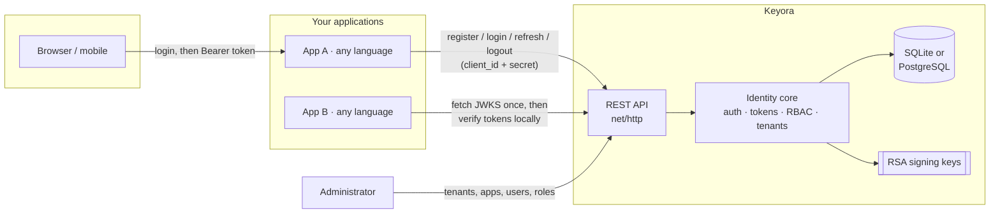

# Keyora

**One Identity. Every Application.**

[](https://github.com/rabbicse/keyora/actions/workflows/ci.yml)
[](LICENSE)

Keyora is a self-hosted identity and authentication server. Run it next to your
applications and it handles sign-up, sign-in, sessions, tokens, roles and permissions
for all of them, over a plain REST API that any language can call.

It is written in Go, ships as a single static binary, and its core has **no third-party
dependencies**: HTTP routing, JWT signing and verification, password hashing, rate
limiting, logging and metrics are built on the Go standard library.

> **Project status: early (v0.1, pre-release).** The features listed below are
> implemented and tested, but Keyora has not had an independent security audit and its
> API may still change before 1.0. Evaluate it accordingly before putting it in front
> of production users. Single sign-on across applications, a consent screen, social
> login and MFA are **not implemented yet** — see the [roadmap](docs/roadmap.md).

## What you get

**Identity**
- Registration, login, profile, password change
- Email verification and password reset (single-use, expiring tokens; SMTP built in)
- Account disable, brute-force lockout and admin unlock

**Tokens and sessions**
- RS256 access tokens (JWT) verifiable offline through a JWKS endpoint
- Opaque refresh tokens, rotated on every use, stored only as hashes
- Refresh-token reuse detection that revokes the whole session
- One session per device; list and revoke them individually; logout
- Signing-key rotation without invalidating live tokens
- Live token introspection

**OAuth 2.0**
- Authorization code flow with mandatory PKCE (S256) and a hosted sign-in page, so
  browser and mobile apps never handle passwords
- Refresh-token and client-credentials grants; authorization server metadata (RFC 8414)
- OpenID Connect on that flow: ID tokens with `nonce`, userinfo, discovery

**Authorization**
- Roles and permissions (RBAC), carried in the access token
- Tenant administrators, scoped to their own tenant

**Multi-tenant, multi-application**
- Tenants isolate users, applications, roles and sessions from each other
- Any number of applications per tenant, each with its own credentials, allowed
  origins and token lifetimes; confidential (server) and public (browser/mobile) types

**Operations**
- Storage adapters: in-memory, SQLite (embedded, zero setup) and PostgreSQL — directly or
  through PgBouncer in transaction-pooling mode — with built-in migrations
- Structured JSON logs, request IDs, Prometheus metrics, liveness/readiness probes
- Per-IP rate limiting, CORS, security headers, audit trail of security events
- Graceful shutdown, a 16 MB container image running as non-root

## Quick start

You need Docker, **or** Go 1.26+ to build from source.

### 1. Start Keyora

```sh
export KEYORA_ADMIN_KEY="$(openssl rand -hex 32)"   # root management credential
```

With Docker (embedded SQLite, data in a volume):

```sh
docker compose -f deploy/docker-compose.sqlite.yml up -d --build
```

Or from source:

```sh
make build && ./bin/keyora
```

Check it is up:

```sh
curl http://localhost:8080/readyz
# {"database":"up","status":"ok","version":"dev"}
```

### 2. Create a tenant and an application

```sh
curl -X POST http://localhost:8080/api/v1/tenants \
  -H "Authorization: Bearer $KEYORA_ADMIN_KEY" -H "Content-Type: application/json" \
  -d '{"slug": "acme", "name": "Acme Inc."}'
# {"data":{"id":"7ea34700-…","slug":"acme",…},"meta":{…}}

export TENANT_ID=<id from the response>

curl -X POST http://localhost:8080/api/v1/tenants/$TENANT_ID/applications \
  -H "Authorization: Bearer $KEYORA_ADMIN_KEY" -H "Content-Type: application/json" \
  -d '{"name": "web", "type": "confidential"}'
# {"data":{…,"client_id":"app_b998…","client_secret":"kys_LWOo…"},"meta":{…}}

export CLIENT_ID=<client_id>  CLIENT_SECRET=<client_secret>
```

The client secret is shown once. Keyora stores only its hash.

### 3. Register a user and sign in

```sh
curl -X POST http://localhost:8080/api/v1/auth/register -u "$CLIENT_ID:$CLIENT_SECRET" \
  -H "Content-Type: application/json" \
  -d '{"email": "ada@example.com", "password": "correct horse battery", "name": "Ada"}'

curl -X POST http://localhost:8080/api/v1/auth/login -u "$CLIENT_ID:$CLIENT_SECRET" \
  -H "Content-Type: application/json" \
  -d '{"email": "ada@example.com", "password": "correct horse battery"}'
# {"data":{"access_token":"eyJhbGciOiJSUzI1NiIs…","token_type":"Bearer","expires_in":900,
#          "refresh_token":"kyr_…","session_id":"…","user":{…}},"meta":{…}}

export ACCESS_TOKEN=<access_token>
curl http://localhost:8080/api/v1/users/me -H "Authorization: Bearer $ACCESS_TOKEN"
```

### 4. Protect your own API

Your application verifies the access token itself — no call to Keyora per request.
In Go, with the dependency-free `guard` package:

```go
g, err := guard.New(guard.Config{
    Issuer:   "http://localhost:8080",        // Keyora's KEYORA_ISSUER
    Audience: os.Getenv("KEYORA_CLIENT_ID"),  // only accept tokens issued to this app
})

mux.Handle("GET /orders",
    g.Middleware(guard.RequirePermission("orders:read")(http.HandlerFunc(listOrders))))
```

In any other language, verify the JWT with a standard library against
`/.well-known/jwks.json`. There are complete, runnable examples for each:

| Language | Examples |
|---|---|
| Go | [net/http](examples/golang/standard-library) · [Gin](examples/golang/gin) · [browser sign-in with PKCE](examples/golang/pkce) |
| TypeScript | [Express](examples/typescript/express) · [plain script](examples/typescript/node-fetch) |
| Python | [FastAPI](examples/python/fastapi) · [Flask](examples/python/flask) |
| Java | [Spring Boot](examples/java/spring-boot) · [plain Java](examples/java/plain-java) |
| .NET | [ASP.NET Core](examples/dotnet/aspnet-core) |
| PHP | [plain PHP](examples/php/plain-php) · [Laravel](examples/php/laravel) |

Each API example implements the same small notes API and is checked by the same script,
[`examples/verify.py`](examples/verify.py). Start with [examples/README.md](examples/README.md).

## How it fits together



- Applications talk to Keyora for sign-in and token refresh.
- They verify access tokens **locally** using Keyora's public keys.
- Administrators manage tenants, applications, users and roles through the same API.

More in [docs/architecture.md](docs/architecture.md).

## Configuration

Keyora is configured with environment variables; [`.env.example`](.env.example) lists
all of them with their defaults. The ones that matter first:

| Variable | Default | Purpose |
|---|---|---|
| `KEYORA_ADMIN_KEY` | *(unset)* | Root management credential, at least 32 characters. |
| `KEYORA_ISSUER` | `http://localhost:8080` | Public URL of Keyora; the `iss` of every token. |
| `KEYORA_DB_DRIVER` | `sqlite` | `sqlite`, `postgres`, or `memory` (development only). |
| `KEYORA_DB_PGBOUNCER` | `false` | `true` when PostgreSQL is reached through PgBouncer. |
| `KEYORA_DB_DSN` | `file:./data/keyora.db` | Database location. |
| `KEYORA_KEYS_DIR` | `./data/keys` | Signing keys. Back it up; keep it private. |
| `KEYORA_MAILER` | `log` | `smtp` to send real email. `log` prints tokens to the log. |

## Documentation

| | |
|---|---|
| [Integration guide](docs/integration.md) | Add Keyora to an application, step by step |
| [Authentication](docs/authentication.md) | Flows, tokens, sessions, refresh rotation |
| [Authorization](docs/authorization.md) | Roles, permissions, applications, tenant administration |
| [API conventions](docs/api.md) | Envelope, errors, pagination · [OpenAPI spec](api/openapi.yaml) |
| [Architecture](docs/architecture.md) | Code layout, data model, multi-tenancy |
| [Security model](docs/security.md) | What Keyora defends against, and the trade-offs it makes |
| [Configuration](docs/configuration.md) | Every setting |
| [Deployment](docs/deployment.md) | Production setup, reverse proxy, backups, key rotation |
| [Testing](docs/testing.md) | How the project is tested and how to run it |
| [Roadmap](docs/roadmap.md) | What is not built yet |
| [Origins](docs/assessment.md) | Assessment of the tutorial code Keyora grew out of |
| [Tutorial compatibility and migration](docs/legacy-tutorial-api.md) | Keep tutorial clients working, then move them to Keyora's API |

The running server also serves its API description at `/api/v1/openapi.yaml`.

## Development

```sh
make check        # format check, vet, zero-dependency check, all tests with -race
make test         # tests only
make fuzz         # fuzz the token parser and password verifier
make help         # everything else
```

The repository is three Go modules, so that optional code never becomes a dependency
of the core:

| Module | Path | Third-party dependencies |
|---|---|---|
| Core: server logic, `jwt`, `guard` | `/` | **none** |
| Server binary | `/cmd/keyora` | PostgreSQL and SQLite drivers |
| Gin adapter | `/adapters/gin` | Gin |

The core module builds with Go 1.24+. The server binary and the Gin adapter need Go 1.26+,
because their dependencies do.

See [CONTRIBUTING.md](CONTRIBUTING.md).

## Security

Please report vulnerabilities privately as described in [SECURITY.md](SECURITY.md),
not in public issues.

## License

[GNU General Public License v3.0](LICENSE).
