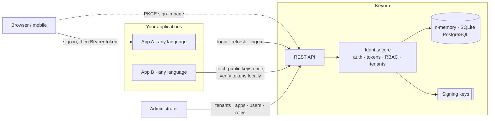

<p align="center">
  <picture>
    <source media="(prefers-color-scheme: dark)" srcset="assets/logo-dark.svg">
    
  </picture>
</p>

<p align="center">
  <strong>Self-hosted identity and authentication for every application you run.</strong><br>
  One static Go binary. Zero third-party dependencies in the core. Any language can use it.
</p>

<p align="center">
  <a href="https://github.com/rabbicse/keyora/actions/workflows/ci.yml"></a>
  &nbsp;·&nbsp; <a href="#quick-start">Quick start</a>
  &nbsp;·&nbsp; <a href="docs/integration.md">Integration guide</a>
  &nbsp;·&nbsp; <a href="api/openapi.yaml">API reference</a>
  &nbsp;·&nbsp; <a href="examples/">Examples</a>
</p>

---

Keyora signs your users in, issues and rotates their tokens, and tells your
applications who is calling and what they may do. You run it next to your services;
they talk to it over a plain REST API and verify its tokens locally.

It implements three open standards and nothing proprietary:

| Standard | What Keyora uses it for |
|---|---|
| [OAuth 2.0](https://datatracker.ietf.org/doc/html/rfc6749) | Authorization code flow with PKCE, refresh tokens, client credentials |
| [JSON Web Token (JWT)](https://datatracker.ietf.org/doc/html/rfc7519) | RS256-signed access tokens any service can verify offline |
| [OpenID Connect](https://openid.net/specs/openid-connect-core-1_0.html) | ID tokens, userinfo and discovery on top of the OAuth flow |

> **Status: early (pre-release).** Everything described here is implemented and
> tested, but Keyora has not had an independent security audit and its API may change
> before 1.0. Single sign-on across applications, a consent screen, social login and
> multi-factor authentication are not built yet — see the [roadmap](docs/roadmap.md).

## Why Keyora

- **It stays small.** A 16 MB container or a single binary, with an embedded database
  if you want one. No runtime, no cluster, no sidecars.
- **You can read all of it.** The core — routing, JWT, password hashing, rate limiting,
  logging, metrics — is the Go standard library and nothing else, and a build check
  keeps it that way.
- **It works with what you already have.** Applications in Go, TypeScript, Python,
  Java, .NET, PHP, Rust or Ruby integrate over HTTP with standard libraries. Nobody needs Go.
- **Security is the default.** PKCE is mandatory, refresh tokens rotate and detect
  theft, secrets are stored only as hashes, and tenants cannot see each other.

## Features

<table>
<tr>
<td width="50%" valign="top">

**Identity**
- Registration, login, profile, password change
- Email verification and password reset
- Brute-force lockout, account disable, admin unlock

**Tokens and sessions**
- RS256 access tokens with a JWKS endpoint
- Rotating refresh tokens with reuse detection
- Per-device sessions you can list and revoke
- Signing-key rotation without logging anyone out
- Live token introspection

</td>
<td width="50%" valign="top">

**OAuth 2.0 and OpenID Connect**
- Authorization code flow with PKCE and a hosted sign-in page
- Refresh-token and client-credentials grants
- ID tokens, userinfo, discovery

**Authorization and tenancy**
- Roles and permissions carried in the token
- Isolated tenants, many applications per tenant
- Confidential (server) and public (browser, mobile) applications

</td>
</tr>
<tr>
<td valign="top">

**Storage**
- In-memory, SQLite, or PostgreSQL
- PostgreSQL through PgBouncer supported
- Built-in migrations

</td>
<td valign="top">

**Operations**
- JSON logs, request IDs, metrics, health probes
- Rate limiting, CORS, security headers
- Audit trail of every security event
- Graceful shutdown, non-root container

</td>
</tr>
</table>

## Quick start

You need Docker, or Go 1.26+ to build from source.

**1. Start Keyora**

```sh
export KEYORA_ADMIN_KEY="$(openssl rand -hex 32)"     # root management credential

docker compose -f deploy/docker-compose.sqlite.yml up -d --build
# or, from source:           make build && ./bin/keyora
# or, the published image:   docker run -p 8080:8080 -e KEYORA_ADMIN_KEY -v keyora-data:/data ghcr.io/rabbicse/keyora

curl http://localhost:8080/readyz
# {"database":"up","status":"ok","version":"dev"}
```

**2. Create a tenant and an application**

```sh
curl -X POST http://localhost:8080/api/v1/tenants \
  -H "Authorization: Bearer $KEYORA_ADMIN_KEY" -H "Content-Type: application/json" \
  -d '{"slug": "acme", "name": "Acme Inc."}'
# {"data":{"id":"7ea34700-…","slug":"acme",…},"meta":{…}}

export TENANT_ID=<id from the response>

curl -X POST http://localhost:8080/api/v1/tenants/$TENANT_ID/applications \
  -H "Authorization: Bearer $KEYORA_ADMIN_KEY" -H "Content-Type: application/json" \
  -d '{"name": "web", "type": "confidential"}'
# {"data":{…,"client_id":"app_b998…","client_secret":"kys_LWOo…"},"meta":{…}}

export CLIENT_ID=<client_id>  CLIENT_SECRET=<client_secret>
```

The client secret is shown once; Keyora keeps only its hash.

**3. Register a user and sign in**

```sh
curl -X POST http://localhost:8080/api/v1/auth/register -u "$CLIENT_ID:$CLIENT_SECRET" \
  -H "Content-Type: application/json" \
  -d '{"email": "ada@example.com", "password": "correct horse battery", "name": "Ada"}'

curl -X POST http://localhost:8080/api/v1/auth/login -u "$CLIENT_ID:$CLIENT_SECRET" \
  -H "Content-Type: application/json" \
  -d '{"email": "ada@example.com", "password": "correct horse battery"}'
# {"data":{"access_token":"eyJhbGciOiJSUzI1NiIs…","token_type":"Bearer","expires_in":900,
#          "refresh_token":"kyr_…","session_id":"…","user":{…}},"meta":{…}}
```

**4. Protect your own API**

Your service verifies the access token itself — no call to Keyora per request. In Go,
with the dependency-free `guard` package:

```go
g, err := guard.New(guard.Config{
    Issuer:   "http://localhost:8080",        // Keyora's KEYORA_ISSUER
    Audience: os.Getenv("KEYORA_CLIENT_ID"),  // accept only tokens issued to this app
})

mux.Handle("GET /orders",
    g.Middleware(guard.RequirePermission("orders:read")(http.HandlerFunc(listOrders))))
```

In any other language, verify the JWT against `/.well-known/jwks.json` with a
standard library — see the examples below.

## Browser and mobile sign-in

Applications that cannot keep a secret use the authorization code flow with PKCE. The
user signs in on Keyora's own page, so your application never handles a password:

```
1. your app  →  /api/v1/oauth/authorize?response_type=code&client_id=…
                  &redirect_uri=…&state=…&code_challenge=…&code_challenge_method=S256
2. Keyora shows its sign-in page and redirects back with a one-time code
3. your app  →  POST /api/v1/oauth/token   code + code_verifier   →   tokens
```

Add `scope=openid` to receive an ID token as well. A complete client is in
[`examples/golang/pkce`](examples/golang/pkce); the flow is explained in
[docs/authentication.md](docs/authentication.md#authorization-code-flow-with-pkce).

## Examples in your language

Every API example is the same small notes service, and all of them are checked by one
script, [`examples/verify.py`](examples/verify.py), which runs 35 checks against a
live Keyora: sign-up, sign-in, tampered and wrong-audience tokens, ID tokens, roles and
permissions, refresh, real token expiry, logout and refresh-token replay.

| Language | Examples |
|---|---|
| Go | [net/http](examples/golang/standard-library) · [Gin](examples/golang/gin) · [browser sign-in with PKCE](examples/golang/pkce) |
| TypeScript | [Express](examples/typescript/express) · [plain script](examples/typescript/node-fetch) |
| Python | [FastAPI](examples/python/fastapi) · [Flask](examples/python/flask) |
| Java | [Spring Boot](examples/java/spring-boot) · [plain Java](examples/java/plain-java) |
| .NET | [ASP.NET Core](examples/dotnet/aspnet-core) |
| PHP | [plain PHP](examples/php/plain-php) · [Laravel](examples/php/laravel) |
| Rust | [axum](examples/rust/axum) |
| Ruby | [Sinatra](examples/ruby/sinatra) |

Start with [examples/README.md](examples/README.md).

## How it fits together



- Applications call Keyora to sign users in and to refresh tokens.
- They verify access tokens **locally** with Keyora's public keys.
- Administrators manage tenants, applications, users and roles through the same API.

## Configuration

Keyora is configured with environment variables. [`.env.example`](.env.example) lists
every one with its default; these matter first:

| Variable | Default | Purpose |
|---|---|---|
| `KEYORA_ADMIN_KEY` | *(unset)* | Root management credential, at least 32 characters |
| `KEYORA_ISSUER` | `http://localhost:8080` | Public URL of Keyora; the issuer of every token |
| `KEYORA_DB_DRIVER` | `sqlite` | `sqlite`, `postgres`, or `memory` (development only) |
| `KEYORA_DB_DSN` | `file:./data/keyora.db` | Database location |
| `KEYORA_DB_PGBOUNCER` | `false` | `true` when PostgreSQL is reached through PgBouncer |
| `KEYORA_KEYS_DIR` | `./data/keys` | Signing keys. Back it up; keep it private |
| `KEYORA_MAILER` | `log` | `smtp` to send real email; `log` prints tokens to the log |

## Documentation

| Guide | What it covers |
|---|---|
| [Integration](docs/integration.md) | Adding Keyora to an application, step by step |
| [Authentication](docs/authentication.md) | Sign-in flows, tokens, sessions, refresh rotation |
| [Authorization](docs/authorization.md) | Roles, permissions, applications, tenant administration |
| [API conventions](docs/api.md) | Envelope, errors, pagination — and the [OpenAPI description](api/openapi.yaml) |
| [Architecture](docs/architecture.md) | Code layout, data model, multi-tenancy, storage adapters |
| [Security model](docs/security.md) | What Keyora defends against and the trade-offs it makes |
| [Configuration](docs/configuration.md) | Every setting |
| [Deployment](docs/deployment.md) | Production setup, reverse proxy, PgBouncer, backups, key rotation |
| [Testing](docs/testing.md) | How the project is tested and how to run it |
| [Legacy compatibility and migration](docs/legacy-tutorial-api.md) | Keeping older clients working, then moving them over |
| [Roadmap](docs/roadmap.md) | What is not built yet |

A running server also serves its API description at `/api/v1/openapi.yaml`.

## Development

```sh
make check        # format check, vet, zero-dependency check, all tests with the race detector
make test         # tests only
make fuzz         # fuzz the token parser and password verifier
make help         # everything else
```

The repository is three Go modules, so optional code never becomes a dependency of
the core:

| Module | Path | Third-party dependencies |
|---|---|---|
| Core: server logic, `jwt`, `guard` | `/` | **none** |
| Server binary | `/cmd/keyora` | PostgreSQL and SQLite drivers |
| Gin adapter | `/adapters/gin` | Gin |

The core builds with Go 1.24+; the server binary and the Gin adapter need Go 1.26+.
See [CONTRIBUTING.md](CONTRIBUTING.md).

## Security

Please report vulnerabilities privately, as described in [SECURITY.md](SECURITY.md),
not in public issues.

## License

Keyora is released under the [GNU General Public License v3.0](LICENSE).
