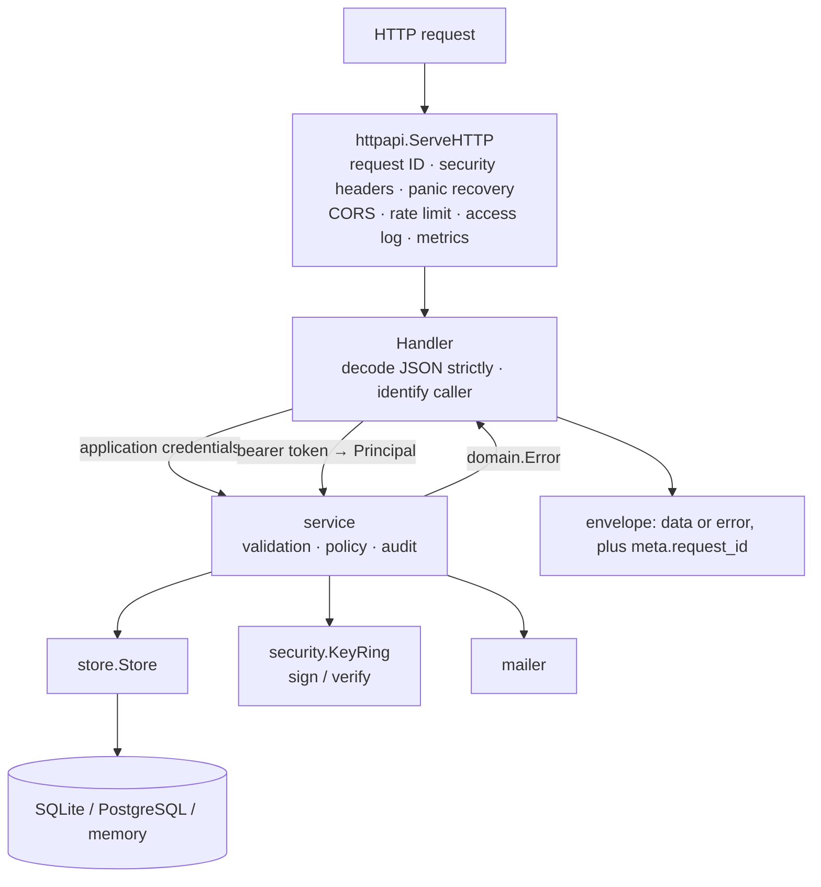
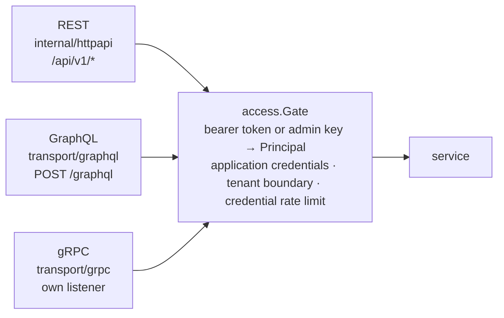
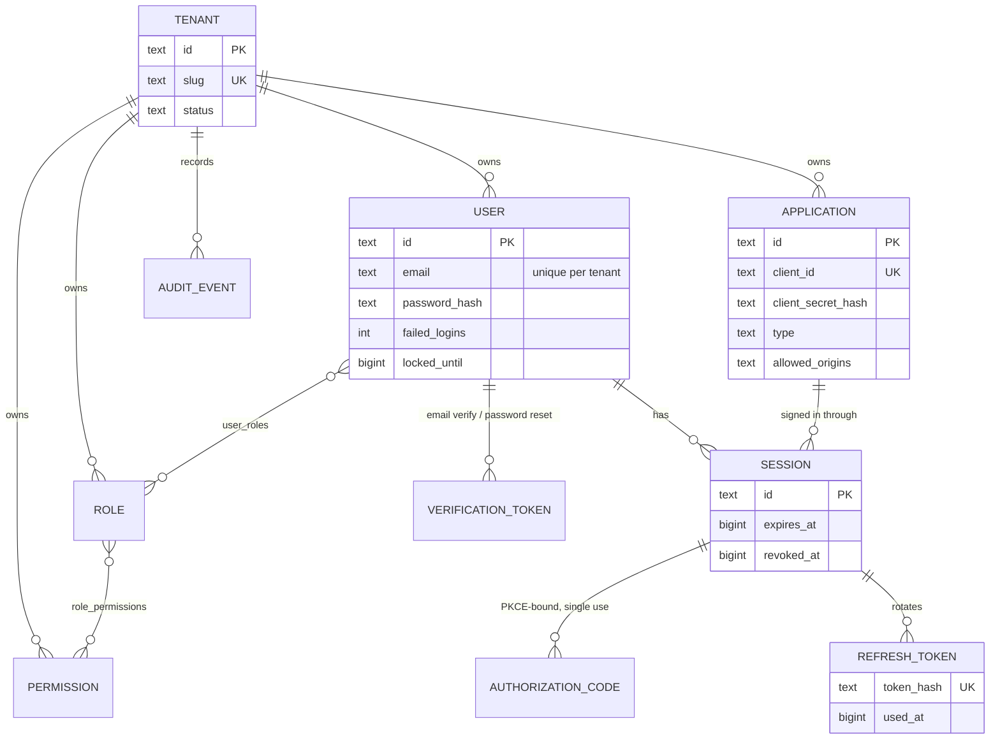

# Architecture

## Design goals

1. **The core depends on nothing but the Go standard library.** Every third-party
   package is confined to a separate Go module that the core never imports.
2. **Identity logic does not know about HTTP or SQL.** It can be tested in memory and
   is served by three transports — REST, GraphQL and gRPC — that share it.
3. **API only.** Keyora serves no pages, sets no cookies and never redirects a
   browser. Every user interface belongs to the application; Keyora is the API behind it.
4. **Tenant isolation is enforced at the lowest layer**, not by callers remembering to
   filter.
5. **Pragmatic over layered.** One package per concern, interfaces only where there are
   really two implementations.

## Repository layout

```
keyora/
├── go.mod                    core module — zero dependencies
├── jwt/                      public: RS256 JWT + JWKS (sign, verify)
├── guard/                    public: verify Keyora tokens in a Go service (net/http middleware)
├── api/openapi.yaml          REST API description (embedded into the binary)
├── internal/
│   ├── domain/               entities and the error vocabulary
│   ├── security/             password hashing, random tokens, signing key ring
│   ├── service/              use cases: auth, tokens, sessions, RBAC, tenants, applications
│   ├── store/                persistence port (one interface)
│   │   ├── memory/           in-memory adapter
│   │   ├── sqlstore/         PostgreSQL (direct or via PgBouncer) and SQLite adapter + migrations
│   │   └── storetest/        conformance suite every implementation must pass
│   ├── access/               who is calling: shared by every transport
│   ├── httpapi/              REST delivery: routing, middleware, envelope, metrics
│   ├── config/               environment configuration
│   ├── mailer/               SMTP and development mailers
│   ├── ratelimit/            token-bucket limiter
│   └── server/               wiring, CLI, graceful shutdown
├── transport/
│   ├── graphql/              GraphQL delivery — own module; schema.graphql is the contract
│   └── grpc/                 gRPC delivery — own module; proto/ is the contract, keyorapb/ the generated code
├── cmd/keyora/               server binary — own module, links the database drivers and both transports
├── adapters/gin/             Gin middleware — own module
├── examples/                 integrations in Go, TypeScript, Python, Java, .NET, PHP
├── deploy/                   Compose, nginx and Caddy examples
└── docs/
```

### Why several modules

`database/sql` is in the standard library, but drivers are not, and a server that
cannot talk to a database is not useful. The same goes for GraphQL and gRPC: neither is
in the standard library. Rather than give up the zero-dependency core, everything that
needs third-party code lives in a module of its own:

| Module | Imports | Why separate |
|---|---|---|
| `github.com/rabbicse/keyora` | standard library only | The library others import and audit. `make check-deps` fails the build if it ever gains a dependency. |
| `…/keyora/transport/graphql` | a GraphQL execution library | The GraphQL API. A binary that does not want it does not link it. |
| `…/keyora/transport/grpc` | `google.golang.org/grpc`, `protobuf` | The gRPC API. Its `keyorapb` package is also what Go clients import. |
| `…/keyora/cmd/keyora` | `pgx` (PostgreSQL), `modernc.org/sqlite` (pure-Go SQLite), the two transports | `sqlstore` speaks `database/sql`; this module registers drivers and hands the transports to the server. |
| `…/keyora/adapters/gin` | Gin | Only for applications that already use Gin. |

The nested modules use `replace` directives to build against the repository they sit
in, so the server is built from a checkout (or installed from a release binary or
container image) rather than with `go install …@version`.

The two drivers were chosen for being the maintained, widely used options that need no
cgo, which is what lets the binary stay static. Their standard-library alternative
would be to implement the PostgreSQL wire protocol and a storage engine by hand, which
is far more risk than a pinned, widely reviewed driver.

## Request path



- `httpapi` contains no business rules. It turns HTTP into calls on `service` and
  `domain.Error` into status codes. The GraphQL and gRPC transports do the same job for
  their protocols.
- `service` returns `*domain.Error` values with a stable `Code`. Anything else is
  logged and reported to the client as an opaque `internal_error`.
- The middleware chain is a single function (`ServeHTTP`) rather than a stack of
  wrappers, so the order — which is security-relevant — is visible in one place.

## Three transports, one core



- Every operation of the versioned REST API exists in all three transports. They
  differ only in wire format: JSON envelope, GraphQL `data`/`errors`, protobuf
  messages with status codes.
- **Who is calling is decided in one place.** `internal/access` holds the checks that
  matter for security — which credential identifies whom, who may manage which tenant,
  and the per-address limit on operations that take credentials. No transport
  re-implements them, so they cannot drift apart.
- **Error codes are the same everywhere.** A `domain.Error` code such as
  `invalid_credentials` is `error.code` in REST, `extensions.code` in GraphQL and the
  `ErrorInfo` reason in gRPC.
- **The core does not import the other two.** `internal/server` accepts transports as
  `server.Extension` values; `cmd/keyora` passes them in. GraphQL is mounted on the HTTP
  listener behind the REST middleware; gRPC runs a listener of its own and is off until
  `KEYORA_GRPC_ADDR` names an address.

## Data model



Decisions worth knowing:

- **Users belong to a tenant, not to an application.** Every application in a tenant
  signs in the same users; a session records which application opened it. Coupling
  users to one application would make "one identity, every application" impossible.
- **A session is one sign-in on one device.** Refresh tokens rotate inside it. Revoking
  the session is what logout, password reset and reuse detection all do.
- **Access tokens are not stored.** They are self-contained and short-lived; what is
  stored is the session they point to (`sid`).
- **Permissions are a catalogue, roles reference them.** A role cannot be given a
  permission that does not exist in its tenant.
- **Timestamps are Unix milliseconds and lists are JSON text**, so one schema runs
  unchanged on SQLite and PostgreSQL.

## Multi-tenancy

A tenant is a hard boundary. Isolation is enforced in three places, and each is tested
on its own:

1. **Storage.** Every read and write of tenant-owned data takes the tenant ID, and the
   SQL carries `WHERE tenant_id = ?`. An ID from another tenant is simply not found.
   Cross-tenant references are refused — for example a role cannot be assigned to a
   user of another tenant, because the assignment checks that both rows belong to the
   tenant in one query.
2. **Tokens.** Access tokens carry `tid`. Introspection answers `active: false` to an
   application of a different tenant. A refresh token only works for the application
   that issued it.
3. **Management API.** The tenant is in the path (`/api/v1/tenants/{tenant_id}/…`) and
   one function, `tenantAdmin`, decides access to it: the caller holds the root key, or
   is a user of *that* tenant with the `keyora:admin` permission.

The same email address in two tenants is two unrelated accounts with separate
passwords.

What tenancy does **not** give you today: per-tenant signing keys or issuers, per-tenant
password policy, or per-tenant rate limits. All tenants share one key ring and one
issuer.

## Storage abstraction

There is a single `store.Store` interface, with these properties:

- **Atomic operations are methods, not transactions handed to callers.**
  `ConsumeRefreshToken` is one conditional `UPDATE`; `IncrementFailedLogins` is one
  `UPDATE … RETURNING`. Callers cannot get the locking wrong because they never see it.
- **No driver types leak.** `sqlstore` maps driver errors to `domain.ErrNotFound` /
  `ErrConflict` by SQLSTATE or message, without importing a driver.
- **One conformance suite** (`storetest`) runs against the memory store, SQLite,
  PostgreSQL, and PostgreSQL through PgBouncer in transaction-pooling mode. A new backend is done when the suite passes.

Adding MySQL means: a dialect switch for placeholders and upsert syntax in `sqlstore`,
a driver import in `cmd/keyora`, and a run of the suite.

## Extension points

The pieces that planned features plug into already exist:

| Planned | Hooks into |
|---|---|
| Single sign-on across applications | The authorization request accepting an existing session's credential in place of a password |
| Social / external identity providers | A second credential type next to the password on `User` |
| MFA, passkeys | A step between password verification and `issueTokens` in `service.Login` |
| MySQL | `sqlstore` dialects |
| Webhooks, SIEM export | `service.audit`, the single place every security event passes through |
