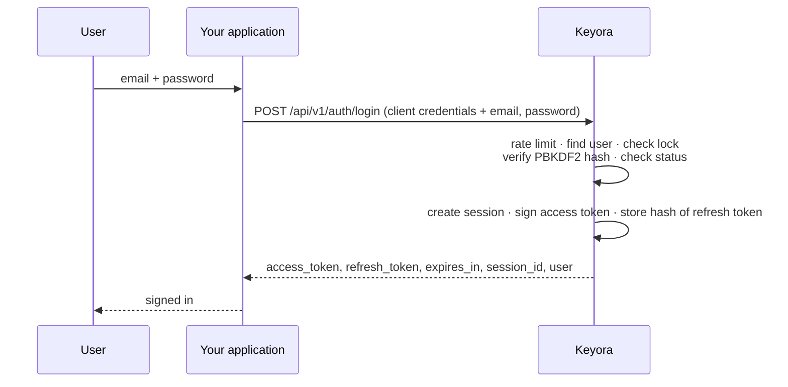
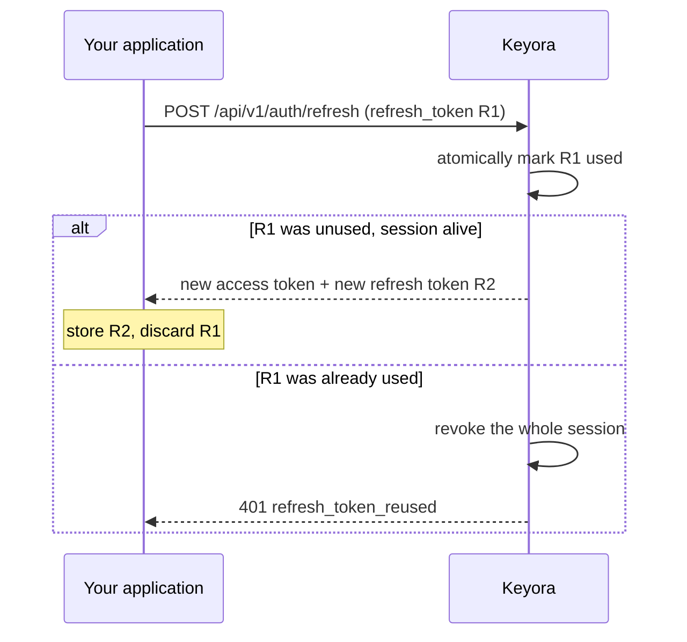
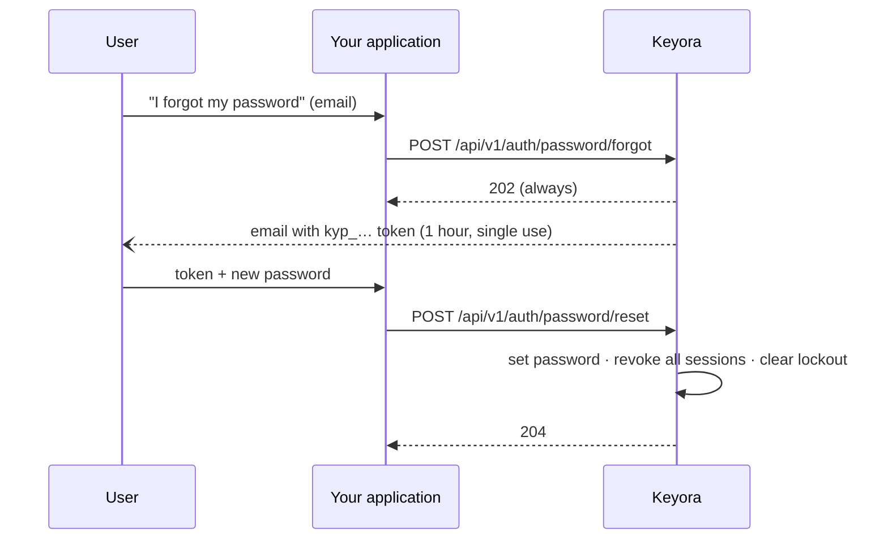
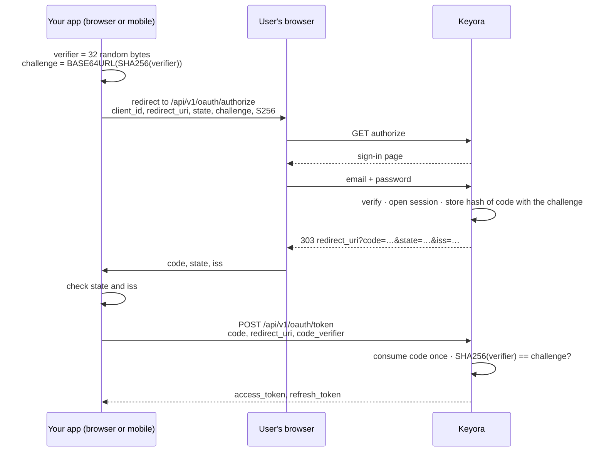

# Authentication

How users sign in, what tokens Keyora issues, and how those tokens live and die.

## The pieces

| Thing | What it is | Lifetime (default) | Where it lives |
|---|---|---|---|
| **Access token** | RS256-signed JWT. Proves who the user is to your APIs. | 15 minutes | Client memory. Not stored by Keyora. |
| **Refresh token** | Opaque random string (`kyr_…`). Exchanged for new tokens. Single use. | 30 days, sliding | Client secure storage. Keyora stores its SHA-256. |
| **Session** | One sign-in on one device. Owns a chain of refresh tokens. | Until revoked or unused for the refresh lifetime | Keyora's database. |

Both lifetimes are configurable globally and per application.

## Two ways to sign a user in

| | Direct login | Authorization code flow with PKCE |
|---|---|---|
| Who collects the password | Your application, which forwards it to Keyora | Keyora's own sign-in page |
| Endpoint | `POST /api/v1/auth/login` | `GET /api/v1/oauth/authorize`, then `POST /api/v1/oauth/token` |
| Best for | A first-party backend with its own login form | Browser and mobile apps, and anything that should never see a password |
| Needs a client secret | Yes, for confidential applications | No. PKCE protects public clients. |

Both end the same way: a session, an access token and a rotating refresh token.

## Direct login



Possible outcomes:

| Status | Code | Meaning |
|---|---|---|
| 200 | — | Signed in. |
| 401 | `invalid_credentials` | Unknown email **or** wrong password. Deliberately indistinguishable. |
| 401 | `invalid_client` | The application's own credentials are wrong. |
| 403 | `account_disabled` | Only reported when the password was correct. |
| 403 | `email_not_verified` | Only when `KEYORA_REQUIRE_EMAIL_VERIFICATION=true`. |
| 423 | `account_locked` | Too many failures. `Retry-After` says how long. |
| 429 | `rate_limited` | Too many requests from this IP. |

## The access token

```json
{
  "iss": "https://id.example.com",
  "sub": "8fa106f0-1b27-4ebe-9639-f355623b9aab",
  "aud": "app_b9988140e4a0445aac735d14a89333f0",
  "exp": 1795445913, "nbf": 1795445013, "iat": 1795445013,
  "jti": "5d0f…",
  "sid": "c2a1…",
  "tid": "7ea34700-cde9-493a-99fb-a9e9ba09b2c8",
  "client_id": "app_b9988140e4a0445aac735d14a89333f0",
  "email": "ada@example.com",
  "roles": ["editor"],
  "permissions": ["orders:read", "orders:write"]
}
```

| Claim | Use |
|---|---|
| `iss` | Must equal your Keyora's `KEYORA_ISSUER`. **Verify it.** |
| `aud` | The `client_id` the user signed in through. **Verify it equals yours.** |
| `exp`, `nbf` | Validity window. **Verify.** |
| `sub` | User ID. Stable; use it as your foreign key. Do not key on `email`. |
| `sid` | Session ID. |
| `tid` | Tenant ID. |
| `roles`, `permissions` | A snapshot taken when the token was issued. |

The header carries `alg: RS256` and a `kid` naming the signing key. Public keys are at
`GET /.well-known/jwks.json`.

## Refresh



**Rotation.** Every refresh returns a new refresh token and retires the old one. Roles
and permissions are re-read, so the new access token reflects any changes.

**Reuse detection.** If a retired refresh token shows up again, either an attacker
stole it or the legitimate client did — Keyora cannot tell which, so it revokes the
session and both parties must sign in again. The event is recorded as
`token.reuse_detected` in the audit trail.

A consequence for client code: **never send the same refresh token twice.** If a
refresh request times out, do not blindly retry it; treat the session as possibly
lost and fall back to sign-in when the retry fails. Serialise refreshes in clients
that fire requests in parallel.

**Sliding expiry.** Each refresh pushes the session's expiry out by the refresh
lifetime. A session that goes unused for that long expires.

## Sign out

`POST /api/v1/auth/logout` revokes the session — with the refresh token and
application credentials, or with just a bearer access token. After that:

- The refresh token is dead.
- Keyora's own API (`/users/me`, management endpoints) rejects the session's access
  tokens immediately.
- Introspection reports them inactive immediately.
- **Offline verification still accepts them until `exp`.** This is inherent to
  self-contained tokens; it is why access tokens are short-lived. Where that window
  is unacceptable, use introspection (below).

Other things that revoke sessions: password reset (all of them), password change (all
but the current one), disabling a user (all), an administrator revoking one, and
refresh-token reuse (that one).

## Verifying tokens in your application

Two ways, which you can mix per endpoint.

**Locally (default).** Fetch the JWKS once and cache it; for each request check the
signature, `exp`, `iss` and `aud`. No network call, and it keeps working if Keyora is
briefly unreachable. Refetch the JWKS when you see an unknown `kid` — that is what a
key rotation looks like — but not more than once every 30 seconds or so.

**By introspection.** `POST /api/v1/auth/introspect` with a confidential application's
credentials returns the token's state *now*: `active: false` if the session was revoked,
the user disabled, or the tenant suspended, and the user's current roles and
permissions otherwise.

| | Local | Introspection |
|---|---|---|
| Latency | None | One round trip |
| Sees logout and disabled users | At expiry | Immediately |
| Sees role changes | At next refresh | Immediately |
| Survives a Keyora outage | Yes | No |

Use introspection for the operations where acting on a just-revoked session would
really hurt.

## Email verification

Registration sends an email with a `kyv_…` token (valid 24 hours, single use).
Your frontend collects it — usually from a link you configure with
`KEYORA_EMAIL_VERIFICATION_URL=https://app.example.com/verify?token={token}` — and
posts it to `/api/v1/auth/email-verification/confirm`.

By default an unverified user can still sign in; set
`KEYORA_REQUIRE_EMAIL_VERIFICATION=true` to refuse them. Re-send with
`/api/v1/auth/email-verification/request`, which answers `202` whether or not the
address exists.

## Password reset



A password that fails validation does not consume the token, so the user can correct
it and try again.

## Brute-force protection

Two independent layers:

- **Per IP:** a token bucket on all `/api/v1/auth/*` and `/api/v1/oauth/*` requests
  (`KEYORA_RATE_LIMIT_PER_MINUTE`, `KEYORA_RATE_LIMIT_BURST`). Stops one source from
  trying many accounts.
- **Per account:** after `KEYORA_MAX_FAILED_LOGINS` consecutive wrong passwords the
  account is locked for `KEYORA_LOCKOUT_DURATION`. Stops many sources from trying one
  account. A successful login or an administrator's unlock resets the count.

The lockout trade-off is discussed in [security.md](security.md#known-trade-offs).

## Authorization code flow with PKCE



1. **Register the redirect URI** on the application (`redirect_uris`). It is matched
   exactly.
2. **Create a verifier** — 43 to 128 characters of `A-Z a-z 0-9 - . _ ~`; 32 random
   bytes, base64url-encoded, is right. Keep it where only your app can read it. Send
   only its SHA-256 (`code_challenge`) with `code_challenge_method=S256`.
3. **Send a random `state`** and check it when the browser comes back. Also check that
   `iss` equals your Keyora issuer.
4. **Exchange the code** within 60 seconds, sending the verifier:

   ```sh
   curl http://localhost:8080/api/v1/oauth/token \
     -d grant_type=authorization_code -d client_id=$CLIENT_ID \
     -d code=$CODE -d redirect_uri=$REDIRECT_URI -d code_verifier=$VERIFIER
   # {"access_token":"eyJ…","token_type":"Bearer","expires_in":900,"refresh_token":"kyr_…",…}
   ```

   Confidential applications also authenticate (HTTP Basic or `client_secret`).
5. **Refresh** with `grant_type=refresh_token` on the same endpoint.

Why PKCE: the code travels through the browser, where another app or a log could
capture it. Without the verifier — which never leaves your app — a captured code is
worthless. Keyora requires PKCE for every application, accepts only `S256`, lets a code
be used once, and revokes the session if a code is presented twice.

Client libraries can find the endpoints at
`GET /.well-known/oauth-authorization-server` (RFC 8414).

### OpenID Connect

Add `openid` to `scope` and the token response also carries an `id_token`: a signed
statement, for the client, of who signed in.

| Scope | Adds to the ID token |
|---|---|
| `openid` | `sub`, `iss`, `aud`, `exp`, `iat`, `auth_time`, `sid`, and `nonce` if you sent one |
| `email` | `email`, `email_verified` |
| `profile` | `name` |

Send a random `nonce` with the authorization request and check that the ID token
carries the same value. `GET /api/v1/oauth/userinfo` returns the same claims for an
access token, and `GET /.well-known/openid-configuration` describes the provider.

An ID token is **not** an API credential. It carries `"token_use": "id"` (access tokens
carry `"access"`), no roles and no permissions; Keyora and the `guard` package reject
it wherever an access token is expected. If you verify tokens with another library,
check `token_use` too, because both kinds are signed by the same keys for the same
audience.

Keyora implements the authorization code flow of OpenID Connect Core; it has not been
through OpenID certification.

What this flow does not do yet: it shows no consent screen and keeps no browser session
at Keyora, so a second application asks for the password again. A complete client is in
[`examples/golang/pkce`](../examples/golang/pkce).

## Service-to-service tokens

A confidential application can get a token for *itself* with the OAuth 2.0 client
credentials grant:

```sh
curl -u "$CLIENT_ID:$CLIENT_SECRET" -d grant_type=client_credentials \
  http://localhost:8080/api/v1/oauth/token
# {"access_token":"eyJ…","token_type":"Bearer","expires_in":900}
```

The token has `sub` = `client_id`, no `sid`, and no roles. This endpoint follows
RFC 6749's wire format rather than the Keyora envelope.

## Signing keys

Keys are RSA private keys in `KEYORA_KEYS_DIR`, one PEM file each; the file name is
the `kid`. The newest (by name) signs; all are published in the JWKS. To rotate:

```sh
keyora keygen        # writes <timestamp>.pem
# restart Keyora (all instances)
```

Tokens signed by the old key keep verifying because its public half stays published.
Delete an old key file only after the longest access-token lifetime has passed since
the rotation. See [deployment.md](deployment.md#signing-keys).
